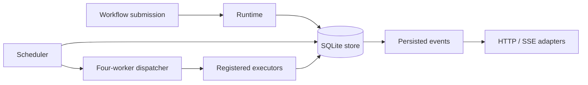

# Forge

A local workflow runtime built with Python and SQLite. Forge persists dependent
task graphs, claims runnable work, executes it with four workers, and records
attempts, artifacts and events. It supports idempotent submission, retries,
cancellation/resume, model-routing metadata and server-sent event adapters.

This is a standalone source extraction of Jared Ji's existing Forge project.
The private application's files and history are excluded. The bundled tasks are
deterministic local text operations; no API keys or external services are needed.

## Recorded demo

[Watch the 94.6-second runtime walkthrough](docs/demos/Forge-real-runtime-walkthrough.mp4)
or browse the [screenshots and capture notes](docs/demos/README.md). The silent
recording shows the real local pipeline, 28 passing tests and source code using
synthetic data. Its terminal presentation was added for recording and is not a
shipped Forge web interface. The [15-minute presentation runbook](docs/demos/Forge-15-minute-demo-runbook.txt)
is a timed speaking plan, not a 15-minute video.

[](docs/demos/Forge-real-runtime-walkthrough.mp4)

## Quick start

Use Python 3.10 or newer with SQLite support. Verification used Python 3.14.7.
The runtime has no third-party dependencies. From a clean checkout:

```sh
git clone https://github.com/xingzhao-ji/Forge.git
cd Forge
python3 -m forge
python3 -m unittest discover -s tests -v
```

The command runs the actual scheduler, workers and SQLite store on synthetic text:
`parse.text.extract` feeds `text.stats`. It prints persisted events and the final
outputs, including five words. Its temporary database is removed on exit.
To retain synthetic state, use `python3 -m forge --data-dir ./demo-state`.
This is a runnable command-line example, not a hosted web demo.

Optional installation into a virtual environment:

```sh
python3 -m venv .venv
. .venv/bin/activate
python -m pip install .
forge-demo
```

The optional package build uses setuptools. Running directly from the checkout
requires no package downloads.

## Architecture



| Module | Responsibility |
| --- | --- |
| [runtime.py](forge/runtime.py) | Compose components under an explicit data directory; register local tasks |
| [store.py](forge/store.py) | Validate DAGs and idempotency, persist state transitions and attempts, claim tasks and recover expired leases |
| [scheduler.py](forge/scheduler.py), [dispatcher.py](forge/dispatcher.py) | Poll runnable work and execute it with a bounded thread pool; classify errors and schedule retries |
| [executors.py](forge/executors.py), [local_tasks.py](forge/local_tasks.py) | Executor contracts, registry, original inline-text parser and a small deterministic counting example |
| [routing.py](forge/routing.py), [registry.py](forge/registry.py) | Rank supplied model metadata, preserve attempt plans, and manage registry snapshots |
| [api.py](forge/api.py) | Framework-neutral workflow/status/cancel/resume/registry and SSE handlers |

The HTTP adapters accept an application's handler object; this repository does
not start an HTTP server or import the private workspace gateway. The routing
engine handles metadata only. Cloud-provider executors and private provider
configuration are not included.

Use `ForgeRuntime(data_directory)` as a context manager, or call `start()` and
`stop()`. Register custom `BaseExecutor` implementations before starting work.
After stopping, create a new runtime pointing at the same directory to reopen
persisted state. Custom executors are trusted Python code.

## Verification and limits

On October 12, 2026, **28 tests passed** on Python 3.14.7. The suite contains
22 retained store/registry/routing tests and six standalone integration checks.
The integration checks use real temporary SQLite databases and workers to verify
dependent outputs, idempotent API submission, SSE cursor replay, persistence after
reopening, transient retry, cancellation/resume, and the four-worker bound.
Network connections are blocked in the integration tests. Provider names and
scores in routing fixtures are synthetic test metadata, not provider benchmarks.

This is a single-process local runtime, not a distributed queue. Four workers are
a per-process bound. Cancellation does not forcibly interrupt running Python
code. The scheduler polls every 0.5 seconds; its default task lease is 30 seconds.
The bundled dispatcher does not renew long-running task leases, so arbitrary
long-running jobs and exactly-once external side effects are not guaranteed.
The stop path waits for workers; custom executors must finish or bound their work.
Add authentication and request/resource limits before exposing the API adapters
through any network server.

No production adoption, throughput improvement, upstream contribution or live
cloud-provider validation is claimed. The older private workspace's **7.634 ms
to 0.647 ms** measurement concerned refresh of unchanged synthetic note files.
That note-index helper is not included here, and the result is not a Forge
workflow-throughput benchmark.

## Provenance and license

[Provenance](docs/PROVENANCE.md) and [source hashes/change boundaries](docs/PROVENANCE.json)
describe the extraction. No personal notes/photos, existing runtime database,
credentials, unrelated application routes or private Git history are included.
The source is public for review; [LICENSE.md](LICENSE.md) grants no new blanket
open-source license. Python, SQLite and setuptools retain their own licenses.
