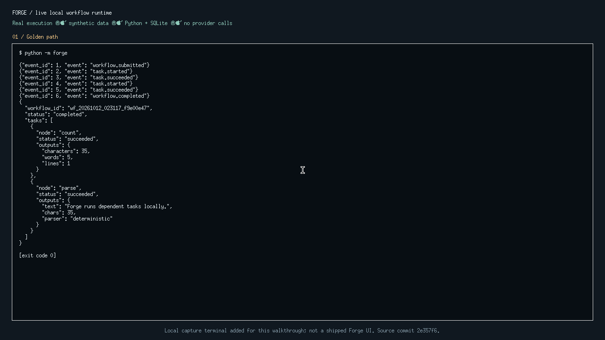
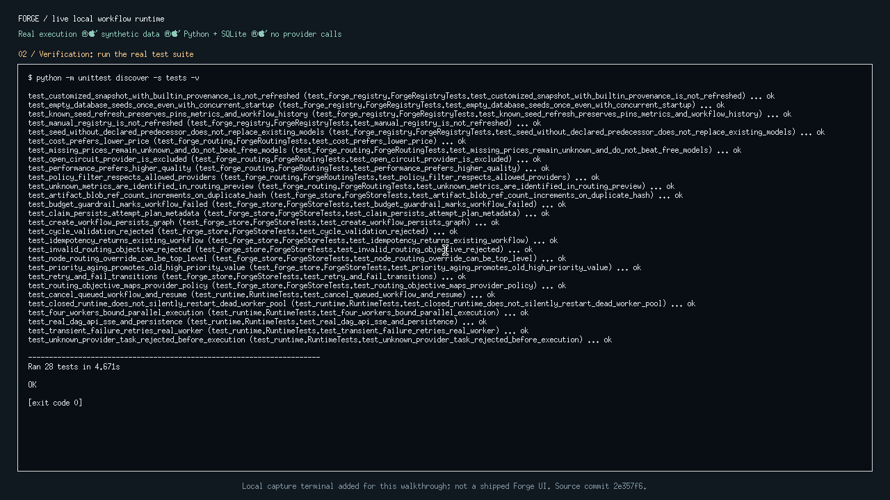
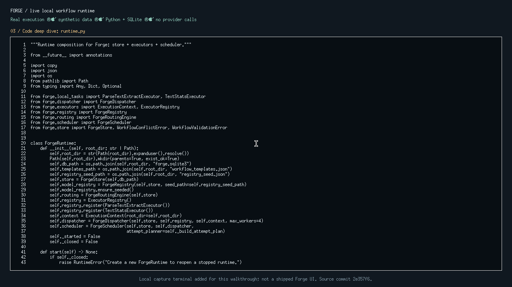

# Recorded Forge demonstration

[Watch or download the MP4](Forge-real-runtime-walkthrough.mp4) ·
[Read the 15-minute presentation runbook](Forge-15-minute-demo-runbook.txt)

The 94.6-second silent recording shows the actual local `python -m forge`
pipeline, a passing 28-test run, and source browsing. It uses synthetic text and
no provider calls. The terminal presentation was added for this recording;
it is not a shipped Forge frontend or a hosted interactive application.

The source captured is commit
[`2e357f6`](https://github.com/xingzhao-ji/Forge/tree/2e357f60b36d66abf2da3ffaf1313ba5d6788542).
The runbook outlines a separate 15-minute explanation and live demonstration;
the short video is supporting footage, not that complete presentation.

## Screenshots

## Capture details

- H.264 MP4, 1280 × 720, 15 fps, 1,419 frames, 94.6 seconds; no audio stream.
- The original MP4, three screenshots and runbook are preserved byte for byte.
- Publication checks fully decoded the video, inspected the screenshots and
  sampled video frames, and scanned the runbook, file metadata and OCR of 95
  one-second video samples for recognizable credentials and personal paths.
- No new runtime or test result is claimed by this documentation-only upload.
  See the main [verification scope](../../README.md#verification-and-limits).

The note-index refresh measurement is not a workflow-throughput result. This
recording establishes local synthetic execution, not adoption, production
scalability or live cloud-provider behavior.
